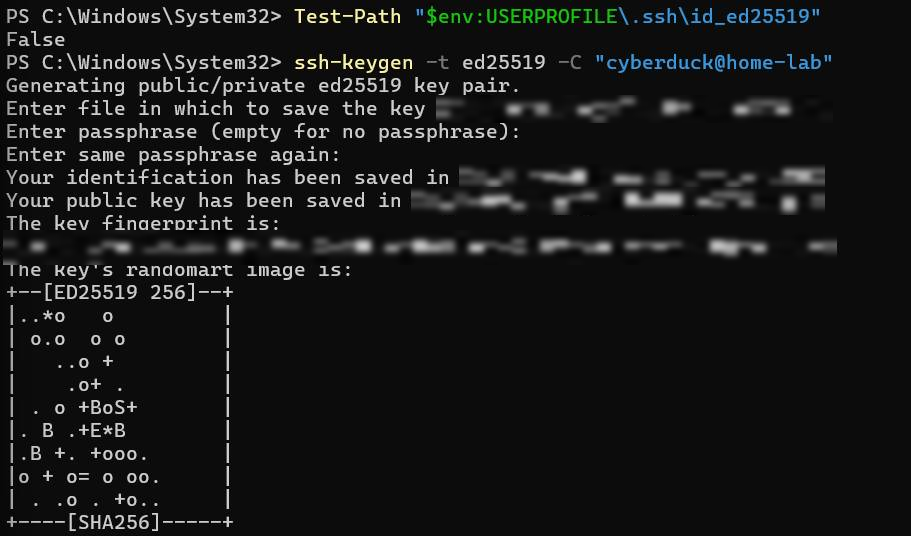
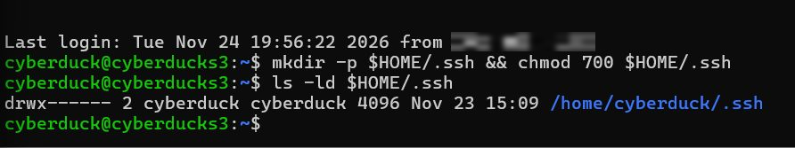
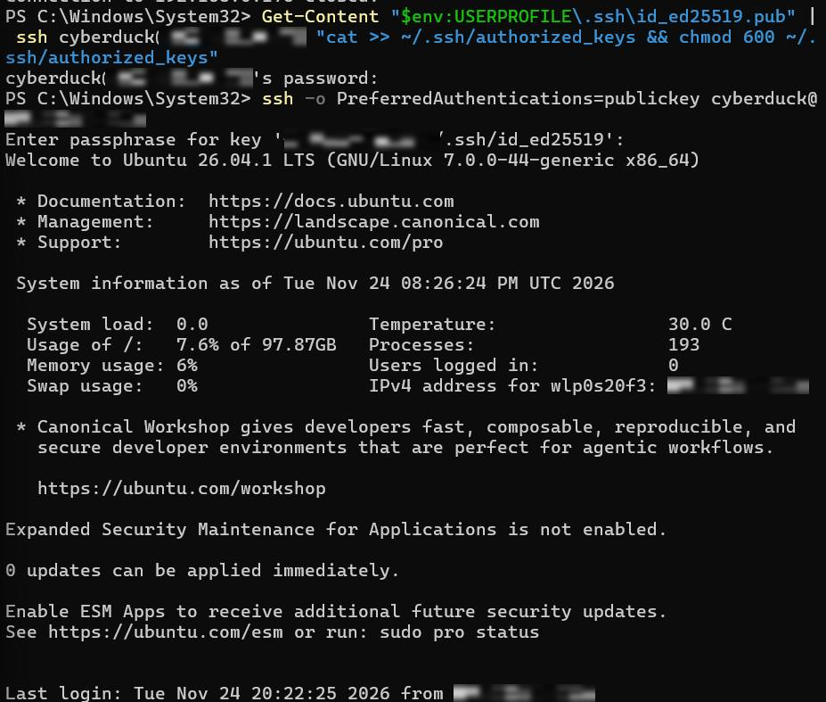
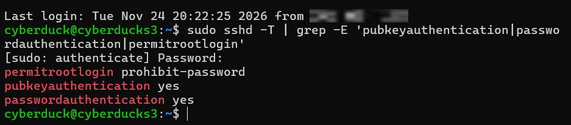
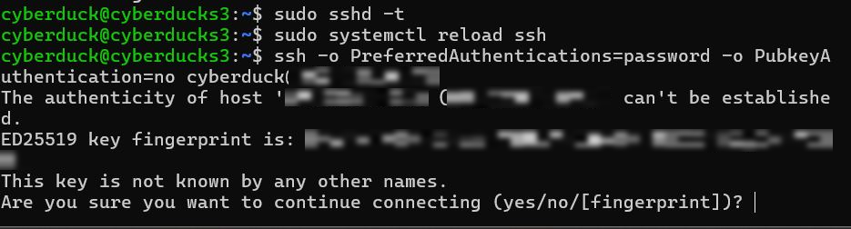

# Infrastructure Setup & SSH Security Hardening

## 1. Project Overview

This project documents the initial setup of a physical Ubuntu Server homelab and the process of securing remote administration.

I wanted to repurpose an older laptop into a dedicated Linux server instead of leaving it unused. The goal is to build a practical environment where I can develop skills in Linux administration, networking, cybersecurity, and infrastructure management.

The lab uses two computers:

- **Main Workstation:** A newer laptop running Windows 11, used to manage the server remotely.
- **Physical Server:** An older Lenovo laptop running Ubuntu Server.

Windows was removed from the older laptop and replaced with Ubuntu Server. The machine is configured to operate as a headless server, allowing remote administration without a permanently connected monitor, keyboard, or mouse.

This first stage focuses on server setup, SSH remote access, public key authentication, and SSH security hardening.

## 2. Server Hardware & Configuration

| Component | Configuration |
|---|---|
| Operating System | Ubuntu Server 26.04.1 LTS |
| Kernel | Linux 7.0.0-44-generic |
| CPU | Intel Core i5, 11th Generation |
| RAM | 8 GB |
| Storage | Samsung SSD, approximately 238 GB |
| Network Interface | Intel Wi-Fi 6 AX201 |
| Hostname | cyberducks3 |
| Linux User | cyberduck |
| Connection | Wi-Fi, 5 GHz |
| Remote Administration | OpenSSH |

The server is configured to remain operational when the laptop lid is closed, allowing it to run as a small physical server.

## 3. Network Configuration – Netplan

The first step was connecting Ubuntu Server to the local wireless network using Netplan.

During configuration, I encountered an issue involving the `match` and `set-name` directives. The selected configuration was not compatible with the Wi-Fi setup using the `systemd-networkd` backend.

### Troubleshooting

To resolve the issue, I:

1. Reviewed the Netplan configuration.
2. Removed the incompatible directives.
3. Generated the configuration again.
4. Applied the updated settings.
5. Tested network connectivity.

### Commands Used

```bash
sudo netplan generate --debug
sudo netplan apply
ping -c 4 google.com
```

After correcting the configuration, the server successfully connected to the wireless network and obtained its network configuration through DHCP.

## 4. Remote Administration – OpenSSH

Once network connectivity was working, I configured OpenSSH to manage the server remotely from Windows 11.

This avoids having to connect a monitor, keyboard, or mouse every time I need to administer Ubuntu.

### SSH Connection

From Windows PowerShell:

```powershell
ssh cyberduck@<SERVER_PRIVATE_IP>
```

The connection provides an encrypted remote terminal session to the Ubuntu server.

This was the first step toward operating the laptop as a headless server.

## 5. SSH Key Authentication – Ed25519

After confirming that remote access worked, I configured public key authentication.

The goal was to use an SSH key pair instead of relying exclusively on the Ubuntu account password.

### Generate the Key Pair

From Windows PowerShell:

```powershell
ssh-keygen -t ed25519 -C "cyberduck@home-lab"
```

I generated an Ed25519 key pair and protected the private key with a passphrase.

Two files were created:

| File | Purpose |
|---|---|
| `id_ed25519` | Private key, stored securely on Windows |
| `id_ed25519.pub` | Public key, installed on Ubuntu |

The private key remains on the Windows workstation. Only the public key is transferred to the server.

### Evidence – Key Generation



### Evidence – Windows SSH Key Files


### Prepare the SSH Directory on Ubuntu

On Ubuntu, I created the `.ssh` directory and restricted its permissions:

```bash
mkdir -p "$HOME/.ssh" && chmod 700 "$HOME/.ssh"
```

The `authorized_keys` file was configured with permissions of `600`.

These permissions help prevent unauthorized local access to SSH authentication files.

### Evidence – SSH Directory Permissions



### Install the Public Key

The public key was transferred from Windows and added to:

```text
~/.ssh/authorized_keys
```

The private key was never transferred.

### Verify Public Key Authentication

I tested the connection using public key authentication:

```powershell
ssh -o PreferredAuthentications=publickey cyberduck@<SERVER_PRIVATE_IP>
```

The server accepted the key and opened a remote session after the private key's passphrase was entered.

### Evidence – Successful SSH Authentication



## 6. SSH Security Hardening

With key-based authentication working, I started tightening the SSH server configuration.

The objectives were:

- Disable password-based SSH authentication.
- Allow public key authentication.
- Disable keyboard-interactive authentication.
- Prevent direct root login through SSH.

### Custom Configuration File

I created a custom configuration file:

```text
/etc/ssh/sshd_config.d/99-hardening.conf
```

It contained:

```text
PasswordAuthentication no
KbdInteractiveAuthentication no
PubkeyAuthentication yes
PermitRootLogin no
```

These settings were intended to require public key authentication and prevent direct root login.

### Evidence – Custom SSH Configuration


## 7. Troubleshooting – SSH Configuration Conflict

This was one of the most important parts of the setup because the first hardening attempt did not behave as expected.

### Problem

Even after creating `99-hardening.conf` with:

```text
PasswordAuthentication no
```

SSH was still accepting password authentication.

The custom configuration looked correct, but the effective SSH configuration showed something different.

### Initial Investigation

I checked the effective configuration:

```bash
sudo sshd -T | grep -E 'pubkeyauthentication|passwordauthentication|permitrootlogin'
```

The output showed:

```text
permitrootlogin no
pubkeyauthentication yes
passwordauthentication yes
```

The last value was unexpected because password authentication was supposed to be disabled.

### Evidence – Effective Configuration Before the Fix



### Investigating the Configuration Files

Instead of assuming the custom file was being ignored, I searched the SSH configuration files:

```bash
sudo grep -RniE '^(Include|Match|PasswordAuthentication|KbdInteractiveAuthentication|PubkeyAuthentication|PermitRootLogin)' /etc/ssh/sshd_config /etc/ssh/sshd_config.d/
```

The investigation revealed two files containing conflicting values.

**File 1:**

```text
/etc/ssh/sshd_config.d/50-cloud-init.conf
```

Contained:

```text
PasswordAuthentication yes
```

**File 2:**

```text
/etc/ssh/sshd_config.d/99-hardening.conf
```

Contained:

```text
PasswordAuthentication no
```

### Root Cause

The issue came from OpenSSH configuration precedence.

Ubuntu includes additional SSH configuration files through the `Include` directive. OpenSSH uses the first obtained value for most configuration options.

Because `50-cloud-init.conf` was processed before `99-hardening.conf`, its `PasswordAuthentication yes` setting took precedence.

This explained why the effective configuration still allowed password authentication.

### Evidence – Configuration Conflict


### Resolution

I corrected the conflicting setting in:

```text
/etc/ssh/sshd_config.d/50-cloud-init.conf
```

The value was changed from:

```text
PasswordAuthentication yes
```

To:

```text
PasswordAuthentication no
```

This removed the conflicting setting that had been enabling password authentication.

## 8. Validate and Apply the Configuration

Before reloading SSH, I checked the configuration syntax:

```bash
sudo sshd -t
```

The command completed without displaying syntax errors.

Next, I checked the effective configuration again:

```bash
sudo sshd -T | grep -E 'pubkeyauthentication|passwordauthentication|permitrootlogin'
```

The final output showed:

```text
permitrootlogin no
pubkeyauthentication yes
passwordauthentication no
```

This time, the effective configuration matched the intended security settings.

### Evidence – Effective Configuration After the Fix


### Reload SSH

After validating the configuration, I applied the changes:

```bash
sudo systemctl reload ssh
```

The service was reloaded without restarting the entire server.

## 9. Final SSH Authentication Tests

I performed separate tests to make sure the new settings were actually working.

### First-Time Host Key Verification

During an initial connection to the server, SSH displayed a host authenticity prompt.

This is part of the SSH host verification process. The client needs to verify the server's host key before trusting and recording it in `known_hosts`.

This is different from user authentication: the host key identifies the server, while the Ed25519 user key authenticates the user.

### Evidence – SSH Host Key Verification



### Test 1 – Password Authentication Rejected

From Windows PowerShell, I forced SSH to use password authentication while disabling public key authentication:

```powershell
ssh -o PreferredAuthentications=password -o PubkeyAuthentication=no cyberduck@<SERVER_PRIVATE_IP>
```

The server rejected the attempt and returned:

```text
Permission denied (publickey).
```

This confirmed that password-only SSH authentication was no longer accepted.

### Evidence – Password Authentication Denied


### Test 2 – Public Key Authentication

I also confirmed that a normal SSH connection still worked:

```powershell
ssh cyberduck@<SERVER_PRIVATE_IP>
```

The connection succeeded using the Ed25519 private key and its passphrase, without asking for the Ubuntu account password.

### Final Result

- Password authentication: disabled.
- Public key authentication: enabled.
- Direct root SSH login: disabled.
- SSH configuration syntax: validated.
- SSH service: reloaded.
- Password-only authentication: rejected.
- Public key authentication: successful.

## 10. Lessons Learned

This project provided practical experience with:

1. Installing and configuring Ubuntu Server on repurposed hardware.
2. Connecting a Linux server to Wi-Fi using Netplan.
3. Managing a headless server remotely.
4. Generating Ed25519 SSH key pairs.
5. Understanding the difference between public and private keys.
6. Configuring SSH directory and file permissions.
7. Securing remote access with public key authentication.
8. Investigating OpenSSH configuration precedence.
9. Identifying conflicting configuration files.
10. Using `sshd -T` to inspect effective settings.
11. Using `sshd -t` to validate configuration syntax.
12. Applying SSH changes safely with a service reload.
13. Testing authentication methods independently.

The SSH configuration issue was especially useful because it showed that editing a configuration file does not automatically mean the service is using the value you expect. Checking the effective configuration was necessary to find the actual problem.

## 11. Skills Practiced

- Linux System Administration
- Ubuntu Server
- Network Configuration with Netplan
- OpenSSH Configuration
- SSH Security Hardening
- Ed25519 Public Key Authentication
- Linux File Permissions
- Windows PowerShell
- Remote Server Administration
- Troubleshooting and Root Cause Analysis
- Configuration Validation
- Security Testing

## 12. Project Status

### Completed

- Installed Ubuntu Server on the older Lenovo laptop.
- Configured wireless networking with Netplan.
- Configured the server for headless operation.
- Established remote administration through OpenSSH.
- Generated an Ed25519 SSH key pair on Windows.
- Installed the public key on Ubuntu.
- Configured SSH directory and file permissions.
- Created custom SSH hardening settings.
- Investigated and resolved the SSH configuration conflict.
- Disabled SSH password authentication.
- Disabled direct root SSH login.
- Verified the effective SSH configuration.
- Confirmed that password-only authentication is rejected.
- Confirmed that public key authentication works.

### Next Steps

The homelab is an ongoing project. The next stage will cover firewall configuration and verification in a separate lab, followed by Linux user and group management, file permissions, and additional server administration exercises.

---

**Project:** Ubuntu Server Homelab  
**Phase 01:** Infrastructure Setup & SSH Security Hardening  
**Status:** Completed
