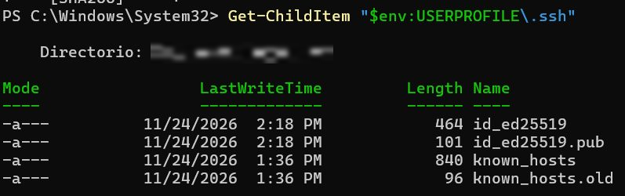
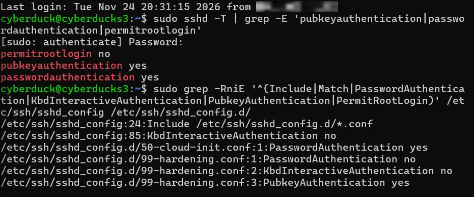
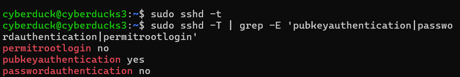

# Lab 01 – Infrastructure Setup and SSH Hardening

## 1. Overview

In this lab, I set up an older Lenovo laptop as a dedicated Ubuntu Server machine and configured remote access from my Windows workstation.

The idea was to reuse hardware I already had instead of leaving it unused. I wanted to build a small homelab where I could practice Linux administration, networking, and security.

I use two computers:

- **Main Workstation:** A newer laptop running Windows 11, used to manage the server.
- **Server:** An older Lenovo laptop running Ubuntu Server.

The server runs without a monitor, keyboard, or mouse connected. I manage it remotely through SSH from my main computer.

This first lab covers the initial server setup, network configuration, SSH access, and the steps I took to secure remote authentication.

## 2. Lab Environment

| Component | Configuration |
|---|---|
| Operating System | Ubuntu Server 26.04.1 LTS |
| Kernel | Linux 7.0.0-44-generic |
| CPU | Intel Core i5 (11th Gen) |
| RAM | 8 GB |
| Storage | Samsung SSD (~238 GB) |
| Network Adapter | Intel Wi-Fi 6 AX201 |
| Hostname | cyberducks3 |
| Linux User | cyberduck |
| Network Connection | Wi-Fi (5 GHz) |
| Remote Access | OpenSSH |
| Client OS | Windows 11 |

The server is configured to stay running when the laptop lid is closed, allowing it to operate as a headless machine.

## 3. Network Configuration with Netplan

Before setting up SSH, I needed to make sure the server could connect to my local network.

Ubuntu Server uses Netplan to manage network configuration. In my case, I was setting up a wireless connection.

During the initial setup, I ran into an issue with the `match` and `set-name` configuration. Rather than keeping a configuration that was not working, I removed those directives and adjusted the Netplan file to use the existing network interface.

I then generated and applied the configuration.

**Commands used:**

```bash
sudo netplan generate --debug
sudo netplan apply
ping -c 4 google.com
```

After making the changes, the server connected to the Wi-Fi network and I was able to test connectivity using `ping`.

This gave me a working network connection before moving on to remote administration.

## 4. Setting Up Remote Access with OpenSSH

Once networking was working, I used OpenSSH to access the Ubuntu server from Windows.

This makes it possible to manage the server through PowerShell without needing to work directly on the laptop.

From Windows PowerShell, I connected using:

```powershell
ssh cyberduck@<SERVER_PRIVATE_IP>
```

I replaced the placeholder with the server's actual private IP address.

After establishing the connection, I could run Linux commands remotely from my Windows workstation.

## 5. SSH Key Authentication

After confirming that SSH access worked, I moved on to public key authentication.

My goal was to use an SSH key pair instead of relying on password-based SSH login.

### 5.1 Generating an Ed25519 Key Pair

I generated the key pair from Windows PowerShell:

```powershell
ssh-keygen -t ed25519 -C "cyberduck@home-lab"
```

I selected a passphrase to protect the private key.

The process created two files:

| File | Purpose |
|---|---|
| `id_ed25519` | Private key |
| `id_ed25519.pub` | Public key |

The private key stays on my Windows workstation. Only the public key is transferred to the Ubuntu server.

**SSH key generation:**


**Files created on Windows:**



### 5.2 Preparing the SSH Directory on Ubuntu

On the Ubuntu server, I created the `.ssh` directory and configured its permissions.

```bash
mkdir -p "$HOME/.ssh"
chmod 700 "$HOME/.ssh"
```

The public key was then added to:

```text
~/.ssh/authorized_keys
```

I also made sure the `authorized_keys` file had the appropriate permissions:

```bash
chmod 600 "$HOME/.ssh/authorized_keys"
```

These permissions help protect the files used for SSH authentication.

**SSH directory and permissions:**


### 5.3 Testing Public Key Authentication

After adding the public key, I tested the connection from Windows:

```powershell
ssh -o PreferredAuthentications=publickey cyberduck@<SERVER_PRIVATE_IP>
```

The connection was successful.

At this point, the server was accepting my Ed25519 key for authentication.


## 6. SSH Security Hardening

With key-based authentication working, I moved on to securing the SSH configuration.

I wanted to make sure that:

- Password-based SSH authentication was disabled.
- Public key authentication remained enabled.
- Keyboard-interactive authentication was disabled.
- Direct root login through SSH was disabled.

To organize these settings, I created a custom configuration file:

```text
/etc/ssh/sshd_config.d/99-hardening.conf
```

The file contained:

```text
PasswordAuthentication no
KbdInteractiveAuthentication no
PubkeyAuthentication yes
PermitRootLogin no
```

Each setting controls a different part of SSH authentication and access.

| Setting | Purpose |
|---|---|
| `PasswordAuthentication no` | Disables password-based SSH login. |
| `KbdInteractiveAuthentication no` | Disables keyboard-interactive authentication. |
| `PubkeyAuthentication yes` | Allows authentication using SSH public keys. |
| `PermitRootLogin no` | Prevents direct root login through SSH. |

**SSH hardening configuration:**


## 7. Troubleshooting – SSH Configuration Conflict

This was one of the more useful parts of the lab because my first attempt at disabling password authentication did not work as expected.

### 7.1 The Problem

Even though I had added:

```text
PasswordAuthentication no
```

to my custom configuration file, SSH was still accepting password authentication.

Instead of assuming the setting was working, I checked the effective SSH configuration.

I used:

```bash
sudo sshd -T | grep -E 'pubkeyauthentication|passwordauthentication|permitrootlogin'
```

The output was:

```text
permitrootlogin no
pubkeyauthentication yes
passwordauthentication yes
```

The problem was clear: password authentication was still enabled.

**Initial SSH configuration check:**


### 7.2 Finding the Cause

I searched the main SSH configuration file and the additional configuration files:

```bash
sudo grep -RniE '^(Include|Match|PasswordAuthentication|KbdInteractiveAuthentication|PubkeyAuthentication|PermitRootLogin)' /etc/ssh/sshd_config /etc/ssh/sshd_config.d/
```

This helped me find two files with different values for `PasswordAuthentication`.

**First file:**

```text
/etc/ssh/sshd_config.d/50-cloud-init.conf
```

It contained:

```text
PasswordAuthentication yes
```

**Second file:**

```text
/etc/ssh/sshd_config.d/99-hardening.conf
```

It contained:

```text
PasswordAuthentication no
```

### 7.3 Understanding the Conflict

The issue was related to how OpenSSH reads its configuration files.

Ubuntu uses the `Include` directive to load additional SSH configuration files. In this setup, the files were processed in alphabetical order.

For most SSH settings, OpenSSH uses the first value it finds.

Since `50-cloud-init.conf` was processed before `99-hardening.conf`, its `PasswordAuthentication yes` setting was taking effect.

This explained why my custom configuration was not producing the result I expected.

**Configuration conflict:**



### 7.4 Fixing the Configuration

I corrected the conflicting setting in:

```text
/etc/ssh/sshd_config.d/50-cloud-init.conf
```

I changed:

```text
PasswordAuthentication yes
```

To:

```text
PasswordAuthentication no
```

This removed the conflicting value that was allowing password authentication.

After making the change, I checked the effective configuration again.

## 8. Validating and Applying the Changes

Before reloading SSH, I checked the configuration syntax:

```bash
sudo sshd -t
```

The command returned no errors, which meant the configuration passed the syntax check.

Next, I checked the effective settings again:

```bash
sudo sshd -T | grep -E 'pubkeyauthentication|passwordauthentication|permitrootlogin'
```

The output was now:

```text
permitrootlogin no
pubkeyauthentication yes
passwordauthentication no
```

This was the result I wanted.

**Corrected SSH configuration:**



Once the configuration was validated, I reloaded the SSH service:

```bash
sudo systemctl reload ssh
```

This applied the changes without restarting the entire server.

## 9. Testing SSH Authentication

After applying the changes, I performed separate tests to check that the authentication settings were working as expected.

### 9.1 Initial Authentication Test

During the initial testing, I checked how SSH handled password-based authentication.

This was important because I needed to confirm whether the server was still accepting account passwords before completing the hardening process.


### 9.2 Testing Password Authentication

From Windows PowerShell, I forced SSH to use password authentication and disabled public key authentication for the test:

```powershell
ssh -o PreferredAuthentications=password -o PubkeyAuthentication=no cyberduck@<SERVER_PRIVATE_IP>
```

The server rejected the connection and returned:

```text
Permission denied (publickey).
```

This confirmed that password-only SSH authentication was no longer accepted.


### 9.3 Testing Public Key Authentication

I then tested a normal SSH connection:

```powershell
ssh cyberduck@<SERVER_PRIVATE_IP>
```

The connection succeeded using my Ed25519 private key.

The Ubuntu account password was no longer needed for SSH authentication. The private key was still protected by its passphrase.

## 10. Final Results

After completing the configuration and testing, these were the results:

| Check | Result |
|---|---|
| SSH remote access | Working |
| Ed25519 key authentication | Working |
| Password-based SSH authentication | Disabled |
| Keyboard-interactive authentication | Disabled |
| Direct root SSH login | Disabled |
| SSH configuration syntax | Validated |
| Effective SSH settings | Verified |
| Password-only authentication test | Rejected |
| Public key authentication test | Successful |

The server was now accessible remotely through SSH using public key authentication.

One important distinction: disabling `PasswordAuthentication` affects SSH login. It does not remove the Linux user's password or prevent its use for local authentication and `sudo`.

## 11. What I Learned

This lab helped me understand more than just how to connect to a Linux server.

I got practical experience with:

- Installing and setting up Ubuntu Server on an older laptop.
- Configuring wireless networking with Netplan.
- Managing a server remotely from Windows.
- Generating and using Ed25519 SSH keys.
- Understanding the difference between public and private keys.
- Setting Linux directory and file permissions.
- Configuring OpenSSH authentication settings.
- Checking the effective SSH configuration with `sshd -T`.
- Validating configuration syntax with `sshd -t`.
- Troubleshooting conflicting configuration files.
- Testing SSH authentication instead of assuming the settings were working.

The biggest lesson for me was the SSH configuration conflict.

I had already changed the setting to disable password authentication, but that did not mean SSH was actually using the value I expected.

Checking the effective configuration helped me find the problem and understand why it was happening.

## 12. Skills Practiced

- Linux System Administration
- Ubuntu Server
- Netplan
- OpenSSH
- SSH Key Authentication
- Linux File Permissions
- SSH Security Hardening
- Windows PowerShell
- Remote Server Administration
- Troubleshooting
- Configuration Validation
- Basic Security Testing

## 13. Lab Status

**Status: Completed**

The initial Ubuntu Server setup and SSH hardening are complete. Remote access is working, public key authentication is enabled, and password-based SSH authentication has been tested and rejected.

This lab is the starting point for the rest of the homelab. Future exercises will build on this server and its existing configuration.

---

**Project:** Ubuntu Server Homelab  
**Lab:** 01 – Infrastructure Setup and SSH Hardening  
**Environment:** Physical Lenovo Laptop + Windows 11 Workstation
