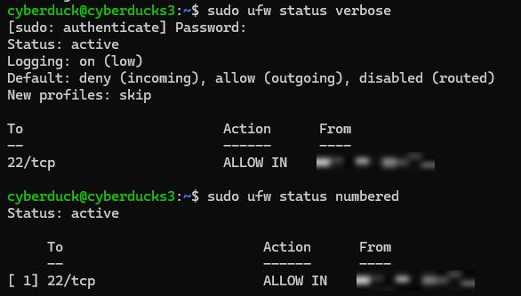
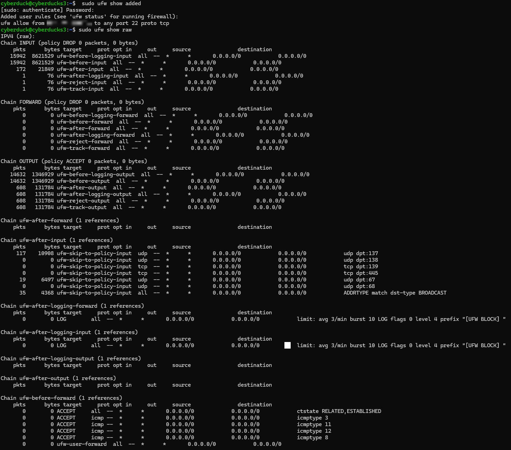
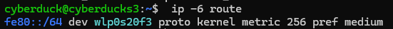
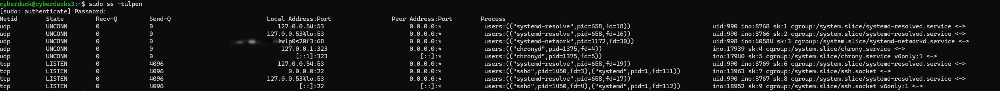
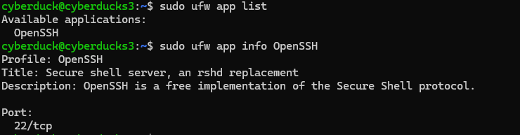
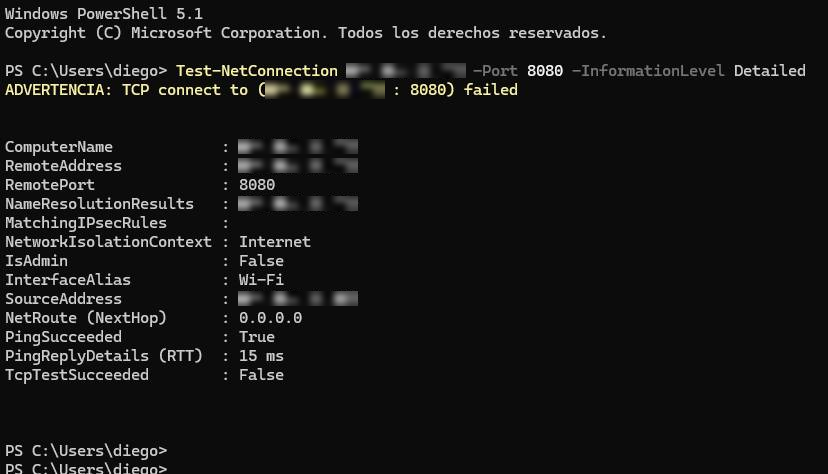
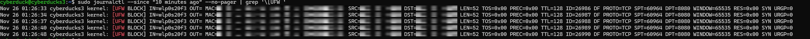
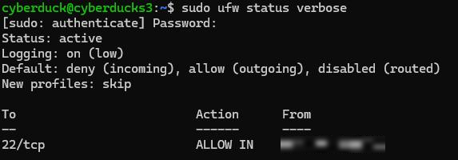

# Lab 02 – UFW Firewall Auditing and Security Verification

## 1. Overview

In this lab, I worked with the existing UFW (Uncomplicated Firewall) configuration on my Ubuntu Server to understand how it was handling incoming network traffic.

The goal was not to create a new firewall configuration, but to inspect the current rules, check which services were listening, investigate firewall logs, and test whether connections were being allowed or blocked as expected.

I used my Windows 11 workstation to perform connectivity tests against the Ubuntu server.

During the lab, I also investigated an IPv6 connectivity issue and checked how UFW events were being recorded by the system.

## 2. Lab Environment

| Component | Configuration |
|---|---|
| Operating System | Ubuntu Server 26.04.1 LTS |
| Firewall | UFW |
| Client System | Windows 11 |
| Remote Administration | OpenSSH |
| Network Connection | Wi-Fi |
| Router | Tenda AX12 Pro V2.0 |
| Router Mode | WISP |

The Ubuntu server and Windows workstation were connected to the same local network.

## 3. Initial Firewall Inspection

I started by checking the current firewall status and its default policies.

```bash
sudo ufw status verbose
```

The firewall was already enabled with the following settings:

| Setting | Configuration |
|---|---|
| Status | Active |
| Incoming Connections | Denied by default |
| Outgoing Connections | Allowed by default |
| Routed Traffic | Disabled |
| Logging | Enabled (Low) |

**Initial UFW status:**



I also wanted to see more of the firewall rules behind UFW, so I used:

```bash
sudo ufw show raw
```

This displayed the underlying firewall rules and helped me get a better idea of how incoming traffic was being handled.

**Raw firewall rules:**



## 4. IPv6 Configuration and Connectivity

Next, I checked whether IPv6 support was enabled in UFW.

```bash
grep '^IPV6=' /etc/default/ufw
```

The output was:

```text
IPV6=yes
```

This confirmed that UFW was configured to handle IPv6 traffic.

**UFW IPv6 configuration:**


However, having IPv6 enabled in UFW does not automatically mean the server has working IPv6 connectivity.

I also checked the server's IPv6 addresses and network configuration.

**Ubuntu IPv6 network information:**



### Testing External IPv6 Connectivity

To check whether the server could reach an external IPv6 address, I ran:

```bash
ping -6 -c 4 2606:4700:4700::1111
```

The command returned:

```text
ping: connect: Network is unreachable
```

**IPv6 connectivity test:**


After checking the network configuration, I found that the server did not have an IPv6 default route.

The Tenda AX12 Pro V2.0 router was operating in WISP mode at the time of the test. IPv6 connectivity was not available through my current network setup.

I left the IPv6 settings in UFW enabled. I did not add any manual IPv6 routes or gateway settings.

This was useful because it helped me understand the difference between enabling IPv6 support in a firewall and actually having an IPv6 network connection.

## 5. Checking Listening Services and Ports

Before testing the firewall, I wanted to know which services were listening on the server.

I used:

```bash
sudo ss -tulpen
```

This command displays listening TCP and UDP sockets, along with additional information about the processes using them.

During the inspection, I identified the following ports:

| Port | Protocol | Service |
|---|---|---|
| 22 | TCP | OpenSSH |
| 53 | TCP/UDP | systemd-resolved |
| 68 | UDP | DHCP client |
| 323 | UDP | chronyd |

SSH was listening for remote connections, while the other services handled tasks such as DNS resolution, network configuration, and time synchronization.

I also checked which addresses the services were bound to, since a service listening only on a local address is different from one listening on a network interface.

**Listening services and ports:**



## 6. Reviewing UFW Application Profiles

I then checked which application profiles were available in UFW.

```bash
sudo ufw app list
```

The system had an application profile named `OpenSSH`.

To see what it contained, I ran:

```bash
sudo ufw app info OpenSSH
```

The profile showed:

```text
Port:
  22/tcp
```

This matched the port used by the SSH service.

**OpenSSH application profile:**



I also reviewed the existing SSH firewall rule.

It allowed TCP port 22 only from the local subnet:

```bash
sudo ufw allow from 192.168.0.0/24 to any port 22 proto tcp
```

This command represents the existing rule; I did not execute it again or add another rule during this audit.

The purpose of this restriction was to allow SSH access from devices within the local network instead of allowing connections from any source.

## 7. Investigating Firewall Logging

After reviewing the firewall rules, I wanted to understand where UFW was recording blocked traffic.

I started by checking the kernel journal for UFW messages:

```bash
sudo journalctl -k --grep=UFW --no-pager -n 20
```

The command did not return any matching entries.

I also checked whether the following log file existed:

```text
/var/log/ufw.log
```

At that point, the file was not present.

### Checking rsyslog

I decided to inspect the rsyslog configuration to see how UFW messages were supposed to be handled.

```bash
sudo grep -v '^#' /etc/rsyslog.d/20-ufw.conf
```

The configuration contained a rule directing UFW messages to `/var/log/ufw.log`.

I also checked the rsyslog service and confirmed that it was active and enabled.

To make sure its configuration did not contain syntax errors, I ran:

```bash
sudo rsyslogd -N1
```

The validation completed successfully without reporting configuration errors.

**UFW logging investigation:**


At this stage, I had confirmed that the rsyslog configuration passed validation, but I still needed to find actual firewall events. I continued with a connectivity test to generate traffic that I could investigate.

## 8. Testing a Blocked Connection

For the next test, I used my Windows 11 workstation to attempt a TCP connection to port 8080 on the Ubuntu server.

First, I checked the server's listening ports to make sure TCP port 8080 was not being used by a service.

From Windows PowerShell, I ran:

```powershell
Test-NetConnection 192.168.0.175 -Port 8080 -InformationLevel Detailed
```

The result was:

```text
PingSucceeded    : True
TcpTestSucceeded : False
```

This told me two things:

- `PingSucceeded: True` – The server was reachable through the network using ICMP.
- `TcpTestSucceeded: False` – The TCP connection to port 8080 could not be established.

**Windows connectivity test:**



At this point, I knew the TCP connection was failing, but I still needed to verify whether UFW was actually blocking it.

A failed TCP connection alone does not prove that a firewall blocked it. I needed to check the firewall logs for more information.

## 9. Reviewing Blocked Traffic Logs

After running the connection test, I went back to Ubuntu and checked the system journal for UFW events.

```bash
sudo journalctl --since "10 minutes ago" --no-pager | grep '\[UFW '
```

This time, I found entries showing blocked traffic.

The logs included information similar to:

```text
[UFW BLOCK]
SRC=192.168.0.100
DST=192.168.0.175
PROTO=TCP
DPT=8080
```

These fields helped me understand what happened:

| Field | Meaning |
|---|---|
| `UFW BLOCK` | Traffic blocked by UFW |
| `SRC` | Source IP address |
| `DST` | Destination IP address |
| `PROTO` | Network protocol |
| `DPT` | Destination port |

The log entries matched the connection attempt to TCP port 8080.

This was the evidence I needed to confirm that UFW had blocked the tested traffic.

**UFW blocked traffic logs:**



## 10. Verifying Authorized SSH Access

After confirming that the connection to port 8080 was blocked, I wanted to make sure the existing SSH access was still working.

From Windows PowerShell, I connected to Ubuntu again:

```powershell
ssh cyberduck@192.168.0.175
```

The connection was successful.

This confirmed that the firewall was still allowing SSH connections from my local network while blocking the tested connection to port 8080.

**Successful SSH connection:**


## 11. Final Firewall Verification

To finish the audit, I checked the firewall status one more time.

```bash
sudo ufw status verbose
```

The final output showed:

```text
Status: active
Logging: on (low)
Default: deny (incoming), allow (outgoing), disabled (routed)
New profiles: skip

To                         Action      From
--                         ------      ----
22/tcp                     ALLOW IN    192.168.0.0/24
```

The configuration was unchanged:

- UFW remained active.
- Incoming connections were denied by default.
- Outgoing connections were allowed.
- Routed traffic remained disabled.
- SSH was allowed only from the local subnet.
- Logging remained enabled at the low level.

**Final UFW configuration:**



No firewall rules were added, removed, or modified during this lab. The goal was to inspect the existing configuration and verify how it behaved.

## 12. What I Learned

This lab helped me understand how to inspect and test a firewall instead of relying only on its status.

I got practical experience with:

- Checking UFW status and default policies.
- Inspecting the underlying firewall rules.
- Understanding the difference between IPv6 support and actual IPv6 connectivity.
- Identifying listening TCP and UDP ports.
- Reviewing UFW application profiles.
- Understanding how SSH access can be restricted to a local subnet.
- Investigating firewall logging and rsyslog.
- Testing TCP connectivity from Windows PowerShell.
- Finding blocked connection attempts in system logs.
- Comparing a blocked connection with an authorized SSH connection.

One of the most useful parts was checking the logs after the failed connection test.

At first, I only knew that the TCP connection was not working. By reviewing the UFW entries, I was able to find evidence of the blocked traffic and connect it to the test I had performed.

It also helped me understand that a firewall should not only be configured. Its behavior needs to be tested and checked through its logs.

## 13. Skills Practiced

- Ubuntu Server Administration
- UFW Firewall Auditing
- Firewall Rule Inspection
- TCP and UDP Port Inspection
- OpenSSH Access Control
- IPv6 Network Diagnostics
- Linux Networking
- rsyslog Configuration Validation
- Firewall Log Investigation
- Windows PowerShell
- Network Connectivity Testing
- Troubleshooting and Verification

## 14. Lab Status

**Status: Completed**

The existing UFW configuration was inspected and tested.

The connection attempt to TCP port 8080 was recorded as blocked by UFW, while SSH access from the local network remained available.

No firewall rules were changed during the process.

---

**Project:** Ubuntu Server Homelab  
**Lab:** 02 – UFW Firewall Auditing and Security Verification  
**Environment:** Physical Ubuntu Server + Windows 11 Workstation
