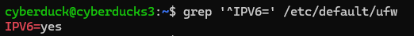
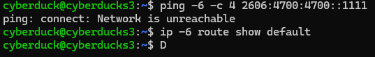
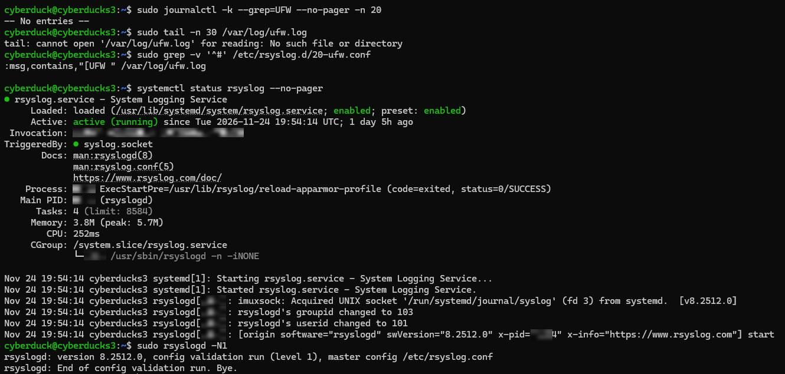
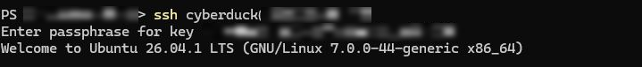

# UFW Firewall Auditing and Security Verification

## Overview

This lab focuses on auditing and testing an existing UFW (Uncomplicated Firewall) configuration on Ubuntu Server.

The goal was to verify that the firewall was enforcing its access rules, identify active network services, investigate firewall logging, and perform practical connectivity tests.

The firewall was already configured before this lab began. Therefore, this exercise focused on auditing and verifying its behavior rather than creating a new configuration.

## Environment

- **Operating System:** Ubuntu Server 26.04.1 LTS
- **Firewall:** UFW (Uncomplicated Firewall)
- **Client System:** Windows 11
- **Remote Administration:** OpenSSH
- **Network Interface:** Wi-Fi
- **Router:** Tenda AX12 Pro V2.0 (WISP mode)

## 1. Initial Firewall Inspection

The first step was to inspect the current UFW status and review its default policies.

The firewall was already enabled with the following configuration:

- Incoming connections: Denied by default
- Outgoing connections: Allowed by default
- Routed traffic: Disabled
- Logging: Enabled (Low)

The following command was used:

```bash
sudo ufw status verbose
```


The internal firewall rules were also inspected to understand how UFW handles incoming traffic.

```bash
sudo ufw show raw
```


## 2. IPv6 Configuration and Connectivity

IPv6 support was checked in the UFW configuration.

```bash
grep '^IPV6=' /etc/default/ufw
```

The result was:

```text
IPV6=yes
```

This confirmed that IPv6 support was enabled in UFW.



The server's IPv6 network configuration and routing information were also inspected.


An external IPv6 connectivity test was performed:

```bash
ping -6 -c 4 2606:4700:4700::1111
```

The server returned:

```text
ping: connect: Network is unreachable
```



Further investigation showed that the server did not have an IPv6 default route.

The Tenda AX12 Pro V2.0 was operating in WISP mode. IPv6 connectivity was not available in the current network setup.

UFW's IPv6 support remained enabled, but external IPv6 connectivity was not established. No manual IPv6 routes or gateway settings were added.

## 3. Listening Services and Ports

The server's listening TCP and UDP ports were inspected using:

```bash
sudo ss -tulpen
```

The following services were identified:

| Port | Protocol | Service |
|---|---|---|
| 22 | TCP | OpenSSH |
| 53 | TCP/UDP | systemd-resolved |
| 68 | UDP | DHCP client |
| 323 | UDP | chronyd |

SSH was listening on the server's network interfaces, while DNS and time synchronization services were bound to local addresses.


## 4. UFW Application Profiles

Available UFW application profiles were reviewed:

```bash
sudo ufw app list
```

The system had an `OpenSSH` profile available.

Its details were inspected using:

```bash
sudo ufw app info OpenSSH
```

The profile defined the following port:

```text
Port:
  22/tcp
```

This matched the existing SSH firewall rule.


The existing rule restricted SSH access to the local network:

```bash
sudo ufw allow from 192.168.0.0/24 to any port 22 proto tcp
```

No additional application profiles or firewall rules were added during this audit.

## 5. Firewall Logging Investigation

The firewall logging configuration was reviewed to understand how UFW events were handled.

Initially, the following command returned no matching entries:

```bash
sudo journalctl -k --grep=UFW --no-pager -n 20
```

The file `/var/log/ufw.log` was also checked but did not exist.

The rsyslog configuration was inspected:

```bash
sudo grep -v '^#' /etc/rsyslog.d/20-ufw.conf
```

The configuration contained a rule directing UFW messages to `/var/log/ufw.log`.

The rsyslog service was checked and confirmed to be active and enabled.

Finally, its configuration was validated:

```bash
sudo rsyslogd -N1
```

The validation completed successfully without reporting configuration errors.



## 6. Testing Unauthorized Connections

A practical test was performed from a Windows 11 computer to check whether UFW would block access to an unused TCP port.

Before the test, the server's listening ports were reviewed and TCP port 8080 was confirmed not to be in use.

The following command was executed in Windows PowerShell:

```powershell
Test-NetConnection 192.168.0.175 -Port 8080 -InformationLevel Detailed
```

The result was:

```text
PingSucceeded    : True
TcpTestSucceeded : False
```

The server was reachable, but the TCP connection to port 8080 could not be established.


## 7. Reviewing Blocked Traffic Logs

After the connectivity test, the system journal was inspected again:

```bash
sudo journalctl --since "10 minutes ago" --no-pager | grep '\[UFW '
```

This time, UFW recorded blocked traffic.

The logs included entries containing:

```text
[UFW BLOCK]
SRC=192.168.0.100
DST=192.168.0.175
PROTO=TCP
DPT=8080
```

These entries confirmed that UFW blocked and logged the attempted TCP connection to port 8080.

The records also provided information about the source address, destination address, protocol, ports, and incoming interface.


## 8. Verifying Authorized SSH Access

After confirming that the unauthorized connection was blocked, a second SSH connection was opened from Windows PowerShell:

```powershell
ssh cyberduck@192.168.0.175
```

The connection was successful.

This confirmed that legitimate SSH access from the local network remained available while the firewall blocked the connection to port 8080.



## 9. Final Firewall Verification

A final review of the UFW status confirmed that the original configuration remained intact.

```bash
sudo ufw status verbose
```

The final result showed:

```text
Status: active
Logging: on (low)
Default: deny (incoming), allow (outgoing), disabled (routed)
New profiles: skip

To                         Action      From
--                         ------      ----
22/tcp                     ALLOW IN    192.168.0.0/24
```

The firewall remained active, incoming connections were denied by default, outgoing connections were allowed, and SSH remained restricted to the local subnet.

No firewall rules were modified during the auditing and testing process.


## Conclusion

This lab provided hands-on experience auditing and verifying an existing firewall configuration on Ubuntu Server.

The practical tests confirmed that UFW blocked unauthorized incoming TCP traffic while preserving legitimate SSH access from the local network.

The investigation also provided experience working with listening services, UFW application profiles, firewall logging, rsyslog, and IPv6 network diagnostics.

One important takeaway was that configuring a firewall is only part of securing a server. Testing its behavior and reviewing its logs are equally important.

## Skills Practiced

- UFW firewall auditing and verification
- Linux network administration
- TCP and UDP port inspection
- SSH access control
- Firewall logging and troubleshooting
- rsyslog configuration validation
- IPv6 network diagnostics
- Connectivity testing with Windows PowerShell
