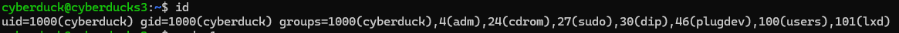
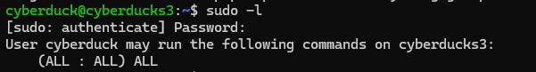
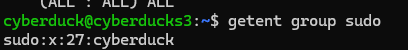
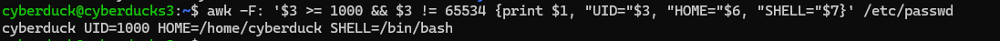
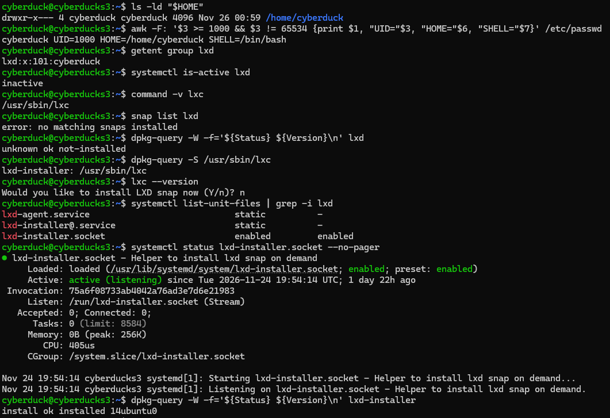
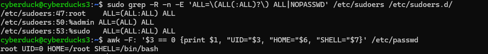
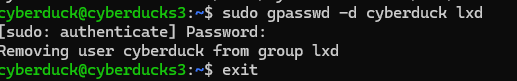
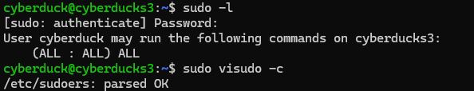
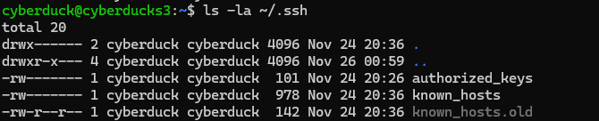
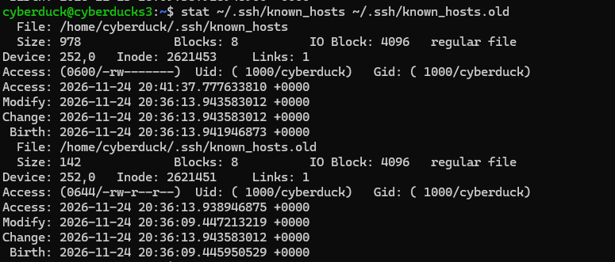

# Lab 03 – Linux User, Group & Privilege Audit

## Overview

This lab focuses on reviewing local user accounts, group memberships, administrative privileges, and file permissions on my Ubuntu Server.

I started by checking the existing user and group configuration, then reviewed sudo access and the permissions assigned to the main user's home directory and SSH files.

During the audit, I found that my account was also a member of the `lxd` group, even though I was not using LXD on this server. I removed that membership and verified that my administrative access through `sudo` remained intact.

The rest of the configuration was left unchanged after reviewing the results.

## Environment

| Component | Details |
|---|---|
| Operating System | Ubuntu Server 26.04.1 LTS |
| Hostname | cyberducks3 |
| Main User | cyberduck |
| User UID | 1000 |
| Primary Group | cyberduck |
| Administration | sudo |
| Remote Access | SSH from Windows 11 |

## 1. User Identity and Group Membership

I started by identifying the active user account and reviewing its group memberships.

The `whoami` and `id` commands helped confirm which account was being used to administer the server, its UID, primary GID, and supplementary groups.



The output identified `cyberduck` as the main administrative user, with UID `1000` and primary group `cyberduck`.

## 2. Sudo Privileges Audit

Next, I checked which administrative commands were available to the current user.

The `sudo --list` command showed that the account had full administrative permissions:

```text
(ALL : ALL) ALL
```

This means the user can execute commands as any user and group, according to the configured sudoers rules.



## 3. Sudo Group Membership

I checked the membership of the `sudo` group to confirm which account had been granted administrative access through group membership.

The command used was:

```bash
getent group sudo
```

The result was:

```text
sudo:x:27:cyberduck
```

This confirmed that `cyberduck` was the only member listed in the `sudo` group.



## 4. Local User Accounts Audit

I reviewed the local account database to identify the accounts configured on the server and distinguish regular user accounts from system accounts.

The account review included checking user IDs, home directories, login shells, and accounts configured with interactive shells.

The interactive shell review identified `root` and `cyberduck` as the accounts with interactive login shells.



## 5. LXD Installer Audit

During the group membership review, I noticed that `cyberduck` was also part of the `lxd` group.

Before removing it, I checked the LXD-related components to understand whether the service was actually being used.

The inspection showed:

- The LXD service was inactive.
- No LXD Snap package was installed.
- The LXD server package was not installed through APT.
- The `lxd-installer` package was installed.
- The `lxd-installer.socket` was enabled and listening.

The installer socket is part of the on-demand installation mechanism. Its presence did not mean that the LXD server itself was running.



## 6. Root Account UID Audit

I also checked which local account had UID `0`.

In Linux, UID `0` identifies the root account and provides full system-level privileges.

The account review returned:

```text
root UID=0 HOME=/root SHELL=/bin/bash
```

The check confirmed that `root` was the only account with UID `0`.



## 7. Removing Unnecessary LXD Group Membership

Since LXD was not required for the current server setup, I decided to remove `cyberduck` from the `lxd` group.

The following command was used:

```bash
sudo gpasswd -d cyberduck lxd
```

The system confirmed:

```text
Removing user cyberduck from group lxd
```

This removed the user's membership from the group. It did not uninstall the LXD installer package or disable its installer socket.



After the change, I closed the SSH session and connected again so the new group membership would be loaded.

I then used `id` to check the updated group list.

## 8. Group Membership Verification

The updated output showed:

```text
uid=1000(cyberduck) gid=1000(cyberduck) groups=1000(cyberduck),4(adm),24(cdrom),27(sudo),30(dip),46(plugdev),100(users)
```

The `lxd` group was no longer present, while `sudo` remained.

This confirmed that the group membership change had been applied successfully without removing the administrative privileges needed to manage the server.


## 9. Sudo Privilege Verification

After removing the LXD group membership, I checked the account's administrative privileges again.

The `sudo -l` command returned:

```text
(ALL : ALL) ALL
```

This confirmed that the account still had full administrative access through sudo.

I also reviewed the sudoers configuration and checked its syntax using:

```bash
sudo visudo -c
```

The validation returned:

```text
/etc/sudoers: parsed OK
```

The main sudoers configuration contained the following group rule:

```text
%sudo   ALL=(ALL:ALL) ALL
```

I also inspected `/etc/sudoers.d/`, which contained only the default README file, and searched the configuration for `NOPASSWD` entries. No matching `NOPASSWD` directive was found in the searched files.

The existing administrative permissions were retained because `cyberduck` is the main administrator of this server.



## 10. Home Directory Permissions

I then reviewed the permissions assigned to the main user's home directory.

The command used was:

```bash
ls -ld /home/cyberduck
```

The output showed:

```text
drwxr-x--- 4 cyberduck cyberduck 4096 Nov 26 00:59 /home/cyberduck
```

The directory is owned by `cyberduck`, with `cyberduck` as its owning group.

Its numeric permissions are `750`:

- Owner: `rwx` — read, write, and execute.
- Group: `r-x` — read and execute.
- Others: `---` — no access.

This means that users outside the owner and owning group cannot access the directory.


## 11. Home Directory File Permissions

I also inspected the contents of the home directory, including hidden files, using:

```bash
ls -la ~
```

The review included shell configuration files, command history, cache files, and the SSH directory.

Some of the permissions found were:

| File or Directory | Permissions |
|---|---|
| `.bash_history` | 600 |
| `.bash_logout` | 644 |
| `.bashrc` | 644 |
| `.cache` | 700 |
| `.lesshst` | 600 |
| `.profile` | 644 |
| `.ssh` | 700 |

The listing showed that the command history and cache directory were restricted to the owner. The SSH directory also had restricted permissions.


## 12. SSH Directory and File Permissions

Since SSH is the main remote administration method for this server, I reviewed the contents and permissions of the user's `.ssh` directory.

The command used was:

```bash
ls -la ~/.ssh
```

The directory contained:

| File | Permissions | Purpose |
|---|---|---|
| `authorized_keys` | 600 | Stores public keys authorized to access the account |
| `known_hosts` | 600 | Stores identities of SSH servers previously contacted |
| `known_hosts.old` | 644 | Previous copy of the known hosts file |

The `.ssh` directory itself had permissions `700`.

These files were inspected without displaying or copying the contents of any private key.



## 13. authorized_keys Ownership and Permissions

I used `stat` to inspect the ownership and permissions of `authorized_keys`.

The command was:

```bash
stat ~/.ssh/authorized_keys
```

The output confirmed:

- Owner: `cyberduck`
- Group: `cyberduck`
- UID: `1000`
- GID: `1000`
- Permissions: `600` (`rw-------`)

The file belongs to the expected user and does not grant access to other local users through its file permissions.


## 14. SSH Directory Ownership and Permissions

I also checked the ownership and permissions of the `.ssh` directory itself:

```bash
stat ~/.ssh
```

The results confirmed:

- Owner: `cyberduck`
- Group: `cyberduck`
- UID: `1000`
- GID: `1000`
- Permissions: `700` (`drwx------`)

Only the owner has access to the directory. This helps protect the files used for SSH authentication.


## 15. known_hosts Ownership and Permissions

Finally, I checked the ownership and permissions of both SSH known hosts files:

```bash
stat ~/.ssh/known_hosts ~/.ssh/known_hosts.old
```

Both files belonged to `cyberduck` and the `cyberduck` group.

The results were:

| File | Permissions | Owner | Group |
|---|---|---|---|
| `known_hosts` | 600 | cyberduck | cyberduck |
| `known_hosts.old` | 644 | cyberduck | cyberduck |

The `known_hosts.old` file is readable by other local users, but it does not contain private SSH keys. No change was considered necessary based on this review.



## Final Review

This lab provided a baseline review of local user accounts, group memberships, sudo privileges, and file permissions on the Ubuntu Server.

The main change was removing `cyberduck` from the `lxd` group because LXD access was not required for the current server setup.

The remaining reviewed settings were kept unchanged:

- Full sudo access for the main administrative account.
- Home directory permissions of `750`.
- SSH directory permissions of `700`.
- `authorized_keys` permissions of `600`.
- `known_hosts` permissions of `600`.
- `known_hosts.old` permissions of `644`.

No additional human administrator accounts were created, and no unnecessary file permission changes were made.

The results provide a baseline for the next stage of the project, where selected user, group, and file permission settings will be hardened when there is a clear technical reason to do so.

**Next Lab:** Linux User & File Permission Hardening.
