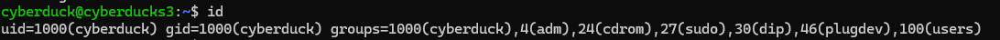
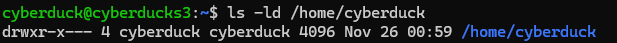
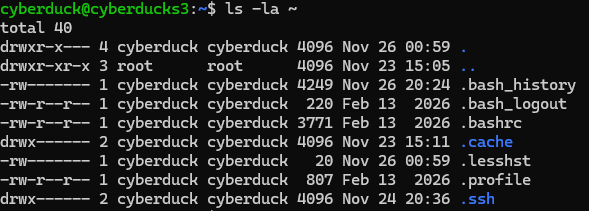
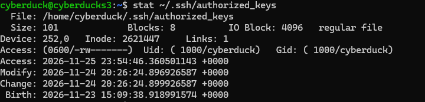
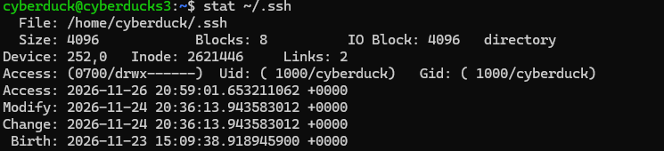

# Lab 03 – Linux User, Group & Privilege Audit

## Overview

This lab covers a review of local user accounts, group memberships, sudo privileges, and file permissions on my Ubuntu Server.

The purpose was to check how the main user account was configured, identify unnecessary group memberships, and review the ownership and permissions of important files and directories.

Most of the work involved inspecting the existing configuration. The only account-level change made during this lab was removing `cyberduck` from the `lxd` group. The remaining settings were kept as they were because the audit did not identify a reason to change them.

## System Environment

| Component | Details |
|---|---|
| Operating System | Ubuntu Server 26.04.1 LTS |
| Hostname | cyberducks3 |
| Main User | cyberduck |
| User UID | 1000 |
| Primary Group | cyberduck |
| Administration | sudo |
| Remote Access | SSH from Windows 11 |

## 1. User Account and Group Membership Review

The first step was to review the account used to administer the server and identify its user ID, primary group, and supplementary groups.

The `id` command showed that `cyberduck` uses UID `1000` and GID `1000`. The account was also a member of several supplementary groups, including `adm`, `cdrom`, `sudo`, `dip`, `plugdev`, `users`, and `lxd`.

The group membership review helped establish which additional permissions were assigned to the account before making any changes.

The system account review also confirmed that `root` was the only account with UID `0`. The interactive shell review identified `root` and `cyberduck` as the accounts with interactive login shells.

## 2. LXD Group Membership Review

During the group review, I found that `cyberduck` was a member of the `lxd` group.

I checked the LXD-related components before deciding whether this membership was necessary. The review showed that:

- The `lxd` service was inactive.
- No LXD Snap package was installed.
- The LXD server package was not installed through APT.
- The `lxd-installer` package was installed.
- The `lxd-installer.socket` was enabled and listening.

The installer socket is part of the on-demand LXD installation mechanism. Its presence did not mean that the LXD server was currently running.

The following check documented the installer package and socket state.


Since I was not using LXD on this server and did not need access to its management interface, I decided to remove the main user from the `lxd` group.

This change removed the user's supplementary group membership. It did not uninstall the LXD installer package or disable its socket.

## 3. Removing Unnecessary LXD Group Membership

The account was removed from the `lxd` group with:

```bash
sudo gpasswd -d cyberduck lxd
```

The command confirmed that the user was removed from the group.


Afterwards, I closed the SSH session and connected again. This was necessary because supplementary group membership is loaded when a new login session starts.

I then ran `id` to verify the updated group list.

The output showed that `lxd` was no longer listed, while `sudo` and the other existing group memberships remained unchanged.



This confirmed that the change was applied without removing the administrative access required to manage the server.

## 4. Sudo Privilege Review

Next, I reviewed the administrative privileges assigned to `cyberduck`.

The `sudo -l` command showed:

```text
(ALL : ALL) ALL
```

This means the account is allowed to run all commands as any user and any group, subject to the configured sudoers rules.

I also reviewed the main `/etc/sudoers` configuration. The relevant rule was:

```text
%sudo   ALL=(ALL:ALL) ALL
```

This rule grants members of the `sudo` group full administrative command access.

The review included checking the syntax of the sudoers configuration with:

```bash
sudo visudo -c
```

The result was:

```text
/etc/sudoers: parsed OK
```

I also inspected `/etc/sudoers.d/`, which contained only the default README file, and searched the main sudoers configuration and included directory for `NOPASSWD` entries. No matching `NOPASSWD` directive was found in that search.

The existing full sudo access was retained because `cyberduck` is the main administrative account for this server. No additional human administrator accounts were created.

The following command was used to confirm the privileges available to the current user.


## 5. Home Directory Permissions

After reviewing account privileges, I moved on to file ownership and permissions.

The first directory inspected was `/home/cyberduck`.

The command:

```bash
ls -ld /home/cyberduck
```

returned:

```text
drwxr-x--- 4 cyberduck cyberduck 4096 Nov 26 00:59 /home/cyberduck
```

The directory is owned by `cyberduck`, and its group owner is also `cyberduck`.

Its numeric permissions are `750`:

- Owner: `rwx` — read, write, and execute.
- Group: `r-x` — read and execute.
- Others: `---` — no access.

This prevents users outside the owner and owning group from accessing the home directory.



I also inspected the directory contents, including hidden files, with:

```bash
ls -la ~
```

The listing showed the permissions assigned to the user's shell configuration files, history, cache, and SSH directory.

Some relevant entries were:

| File or Directory | Permissions |
|---|---|
| `.bash_history` | 600 |
| `.bash_logout` | 644 |
| `.bashrc` | 644 |
| `.cache` | 700 |
| `.lesshst` | 600 |
| `.profile` | 644 |
| `.ssh` | 700 |

The output showed that the shell history and cache directory were restricted to the owner. The SSH directory also had restricted permissions.



## 6. SSH Directory and File Permissions

Because SSH is the main remote administration method for this server, I also reviewed the contents of the user's `.ssh` directory.

The directory was inspected with:

```bash
ls -la ~/.ssh
```

The output showed the following files:

| File | Permissions | Purpose |
|---|---|---|
| `authorized_keys` | 600 | Stores public keys allowed to authenticate to the account |
| `known_hosts` | 600 | Stores identities of SSH servers previously contacted |
| `known_hosts.old` | 644 | Previous copy of the known hosts file |

The `.ssh` directory itself had permissions `700`.

These permissions were reviewed without displaying or copying the contents of any private key.


## 7. SSH File Ownership Verification

I used `stat` to inspect the ownership and permissions of `authorized_keys`.

The command was:

```bash
stat ~/.ssh/authorized_keys
```

The output confirmed:

- Owner: `cyberduck`
- Group: `cyberduck`
- UID: `1000`
- GID: `1000`
- Permissions: `600` (`rw-------`)

The file is owned by the correct account and is not accessible to other local users through its file permissions.



I also checked the `.ssh` directory itself:

```bash
stat ~/.ssh
```

The results confirmed that the directory belongs to `cyberduck` and has permissions `700` (`drwx------`).

This restricts directory access to its owner.



Finally, I checked the ownership and permissions of both `known_hosts` files:

```bash
stat ~/.ssh/known_hosts ~/.ssh/known_hosts.old
```

Both files belonged to `cyberduck` and the `cyberduck` group.

`known_hosts` had permissions `600`, while `known_hosts.old` had permissions `644`.

The latter was left unchanged. It is readable by other local users, but it does not contain private SSH keys. No change was considered necessary based on this review.


## 8. Final Review

The audit confirmed that the main user account had full administrative access through `sudo` and that its home directory and SSH-related files had restricted permissions.

The only change made during this lab was removing `cyberduck` from the `lxd` group because LXD access was not required for the current server setup.

The following settings were reviewed and retained:

- Full sudo access for the main administrative account.
- Home directory permissions of `750`.
- SSH directory permissions of `700`.
- `authorized_keys` permissions of `600`.
- `known_hosts` permissions of `600`.
- `known_hosts.old` permissions of `644`.

No additional user accounts were created, and no unnecessary permission changes were made.

This audit provides a baseline for the next stage of the project, where selected user, group, and file permission settings will be hardened where there is a clear technical reason to do so.

**Next Lab:** Linux User and File Permission Hardening.
